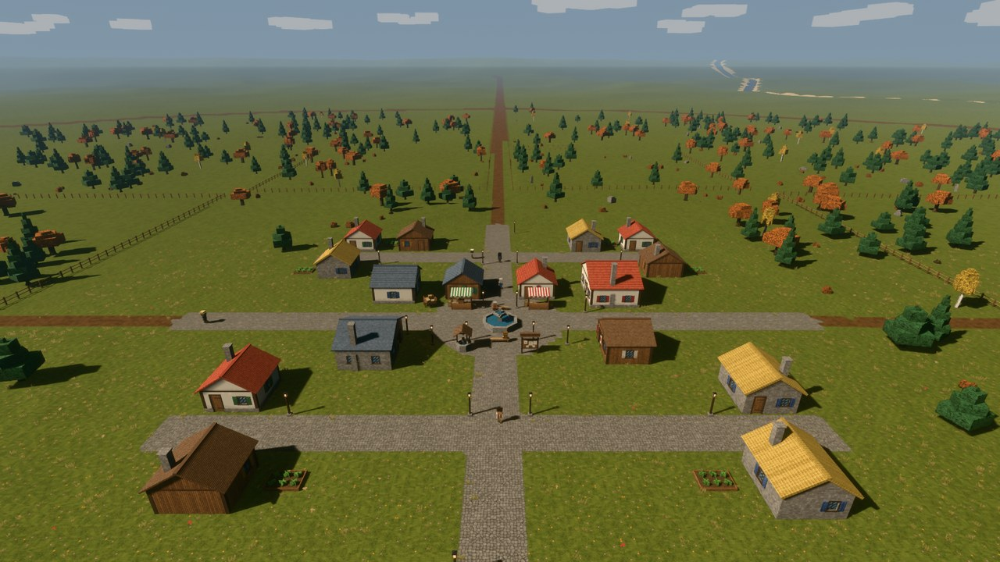
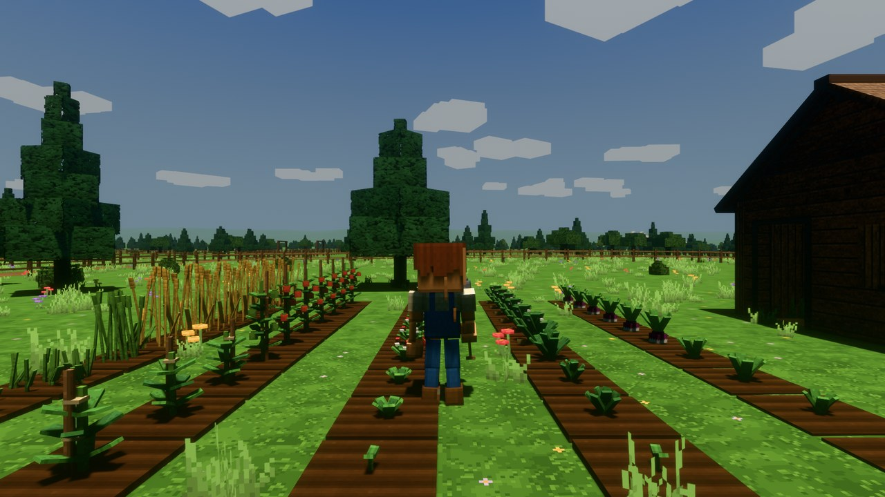
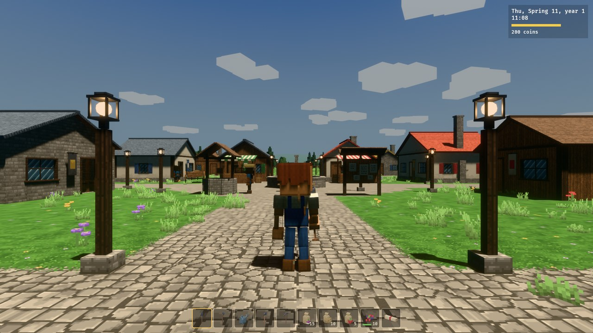
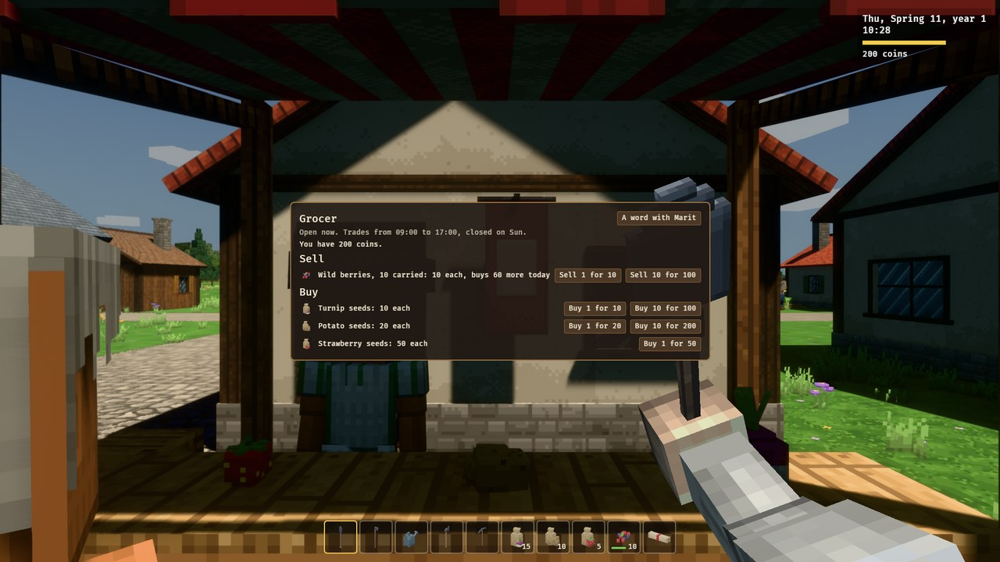
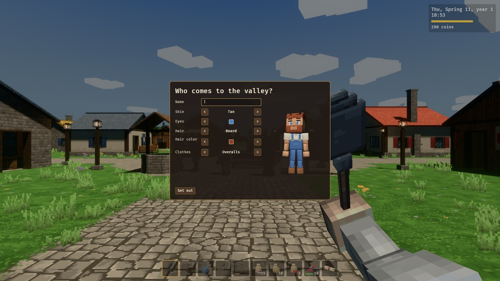
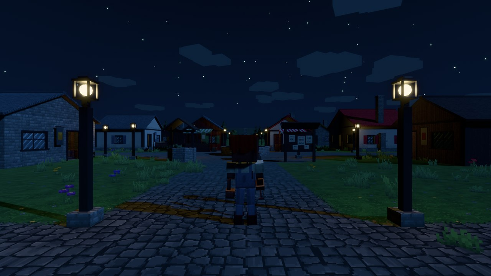
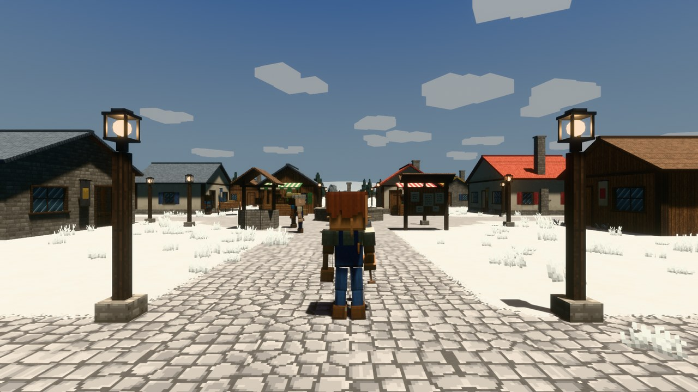

# Messoria

A cozy farming game in a medieval valley, alone or with friends: each
player farms a fenced lot of their own around a village whose people keep
days of their own and can be befriended, as the days and seasons turn. A
world is hosted from the game for a few friends, or on a dedicated server
for a larger group.



| | |
|---|---|
|  |  |
|  |  |
|  |  |

## Download and play

1. Download `messoria-<version>-windows-x64.zip` or
   `messoria-<version>-linux-x64.tar.gz` from the
   [Releases](https://github.com/bryanmzauza/Messoria/releases) page. Each
   has a `.sha256` file beside it to check the download against.
2. Unpack it anywhere (on Linux, `tar -xzf` it). Keep the `assets` folder
   next to the executables.
3. Run `messoria.exe` on Windows or `messoria` on Linux. The executable is
   not signed, so Windows may warn about it: "More info", then "Run anyway".

What it takes, as measured on a Ryzen 7 8700G with its integrated
Radeon 780M graphics, at 1280x720, in the village while hosting: 40 to 55
frames per second on High and 52 to 58 on Medium. A recent integrated GPU
plays it; for High at 60 frames per second, a dedicated GPU. It needs
64-bit Windows 10 or 11, or a 64-bit Linux with glibc 2.35 or newer
(Ubuntu 22.04, Debian 12 or later) and Vulkan drivers, and 8 GB
of memory. A dedicated server with nine players kept each update under
2 ms of its 33 ms tick and used about 100 MB of memory.

The title screen offers:

- **Continue**: the world you played last.
- **New world**: a name, and a seed if you want a particular valley.
- **Your worlds**: your worlds, their dates and when you last played them;
  delete one here, after a second thought.
- **Host for friends**: a world, a port and the share of sleepers that ends
  the night. See [Hosting for friends](#hosting-for-friends).
- **Join a world**: an address, with the ones you joined lately below it.
- **Options** and **Quit**.

The first time you arrive in a world you make your character: body, skin,
eyes, hair and a first outfit, and a name. The game keeps them in your
profile, so you arrive in other worlds as the same person. A card of
controls opens next; `F1` brings it back.

To start out, walk to the notice board on the village square and claim a
lot: the first one is free. Use the cabin deed you were given on your lot
to build your cabin, with a bed, a chest and a wardrobe inside.

Worlds, your profile, your settings and the game's log live in
`%APPDATA%\Messoria` on Windows and `$XDG_DATA_HOME/messoria` (usually
`~/.local/share/messoria`) on Linux; `--data-dir <folder>` moves them. The
profile is how servers know you when you come back: keep it.

## Hosting for friends

Up to 8 players fit in a world hosted from the game.

1. On the title screen, choose **Host for friends** and pick a world; the
   port is 5717 unless you change it. Or open the world you are playing
   from the game menu (`Esc`): **Open the world to friends**.
2. Let the port through your firewall. On Windows, allow Messoria when
   Windows Defender Firewall asks. On Linux with ufw:
   `sudo ufw allow 5717/udp`.
3. Friends on the same network join your local IP address. Find it with
   `ipconfig` on Windows (IPv4 Address) or `ip addr` on Linux; it usually
   looks like `192.168.x.x` or `10.x.x.x`.
4. Friends elsewhere need the port forwarded on your router to your
   machine:
   - Open your router's admin page (often `192.168.0.1` or `192.168.1.1`,
     or the address on a label on the router).
   - Add a port forward for UDP port 5717 to your machine's local IP.
   - Give your friends your public IP, as a site like
     [whatismyip.com](https://www.whatismyip.com) shows it.

   This is the only way in from outside until access codes arrive (see the
   [roadmap](docs/ROADMAP.md#after-the-mvp)).

The game menu lists who is here. **Close the world** there sends every
guest back to their title screen. [docs/hosting.md](docs/hosting.md) covers
all of this at length.

## Dedicated server

`messoria-dedicated-server` (`.exe` on Windows) comes in the same download
and runs from a terminal, without a window:

```sh
./messoria-dedicated-server --port 5717 --world saves/world
```

| Flag | Default | |
|---|---|---|
| `--port <PORT>` | 5717 | UDP port to listen on |
| `--world <FOLDER>` | `saves/world` | Folder the world is saved in, under the working directory unless absolute |
| `--sleep-percent <PERCENT>` | 50 | Share of the players online that must sleep to end the day |
| `--max-players <N>` | 16 | Players the world takes at once |
| `--start-time <HH:MM>` | 06:00 | Time of day a new world starts at |
| `--minute-length <MS>` | | Real milliseconds a game minute lasts, to make days pass faster for testing |

The server saves the world every five minutes, at every dawn and when
stopped with `Ctrl+C`. Every minute it logs how long its updates took.

As a systemd service, with the Linux download unpacked in `/opt/messoria`
and owned by a `messoria` user:

```ini
[Unit]
Description=Messoria dedicated server

[Service]
User=messoria
WorkingDirectory=/opt/messoria
ExecStart=/opt/messoria/messoria-dedicated-server --port 5717
# Stop it as Ctrl+C does, so it saves on the way out.
KillSignal=SIGINT
Restart=on-failure

[Install]
WantedBy=multi-user.target
```

[docs/hosting.md](docs/hosting.md) has the long version.

## Controls

- Mouse: look around. Click the window to take the mouse, `Esc` lets it go.
- `W` `A` `S` `D`: walk. `Shift`: run. `Space`: jump.
- `1` to `0` or the mouse wheel: pick what you hold.
- Left click: use what you hold: dig, till, water, plant, build, eat.
- Right click: use it the other way: raise the ground with the shovel.
- `F`: talk, harvest, pick, open what you look at, sleep in a bed.
- `E`: the backpack, and giving money to a player beside you.
- `V`: the villagers, with your friendship with each.
- `F5`: first person, or third person from behind or the front.
- `F1`: the card of controls.
- `Esc`: close a window, or open the game menu.

The game menu has the options (volume, music, mouse sensitivity, field of
view, graphics quality), opening and closing the world to friends when you
host it, who is here, and the way back to the title screen.

## Status

Version 0.1.0 is the first release: the milestones of the MVP are done,
through the playtest. See the [roadmap](docs/ROADMAP.md) for what is done
and what comes next.

## Building

Messoria is written in Rust with [Bevy](https://bevyengine.org).

Requirements:

- Rust, installed through [rustup](https://rustup.rs). The toolchain version
  (1.98.1) is pinned in `rust-toolchain.toml` and installed automatically.
- Linux only: `libudev-dev`, `libwayland-dev`, `libxkbcommon-dev` and
  `libasound2-dev` (or your distribution's equivalents).

```sh
cargo client    # the game, from its title screen
cargo server    # a dedicated server
cargo bots      # a bot player on a local server
cargo lint      # Clippy across the workspace, warnings as errors
cargo test --workspace
cargo deny check
```

Development runs keep worlds, the profile and the settings in the
workspace's `saves` folder, through `MESSORIA_DATA_DIR` in
`.cargo/config.toml`, and read the assets from the workspace. Arguments go
after `--`:

```sh
cargo client -- --world saves/farm           # play a world in a folder, skipping the title
cargo client -- --world saves/farm --seed 7  # a new world with a seed of your choosing
cargo client -- --host                       # host the world called local (UDP port 5717)
cargo client -- --connect 192.168.0.10       # join a hosted world or a dedicated server
cargo client -- --connect 127.0.0.1 --simulate-latency 150
cargo server -- --minute-length 20           # days that pass quickly
cargo bots -- --bots 2 --farm                # bots that farm and log their harvests
cargo bots -- --bots 8 --roam                # bots that run all over the valley
```

For faster incremental builds while iterating on the client, enable Bevy's
dynamic linking:

```sh
cargo run -p messoria-game --features dev
```

## Repository layout

```
crates/
  calendar/   game time, dates, seasons, sleep rules
  content/    content catalog loaded from data files, with validation
  economy/    wallets, market prices, daily sales limits
  farming/    crop growth, withering, harvests
  inventory/  slots, stacks, quality and spoilage
  save/       versioned save files for worlds, players and settings
  voxel/      terrain storage, edits and meshing
  worldgen/   the valley grown from its seed: shape, river, roads, lots, scenery
  shared/     networking, protocol, simulation shared by server and client
  server/     authoritative game logic
  client/     rendering, input, camera, interface, audio
bins/
  game/              the game (messoria)
  dedicated-server/  the dedicated server (messoria-dedicated-server)
tools/
  loadtest/   bot players for testing (messoria-loadtest)
assets/       content data, models, skins, textures, shaders, music, sounds
docs/         design document, roadmap, architecture, hosting, decision records
```

Game content is data in `assets/data/`, checked on load: the game refuses
to start, naming the problem, if a file is invalid. Models, skins,
textures, music and ambient sound were made for the game; the other sounds
come from CC0 packs, credited in [`assets/CREDITS.md`](assets/CREDITS.md).
The [architecture overview](docs/architecture.md) explains how the crates
fit together.

## Documentation

- [Game design document](docs/design/game-design.md)
- [Roadmap](docs/ROADMAP.md)
- [Architecture](docs/architecture.md)
- [Hosting and dedicated servers](docs/hosting.md)
- [Decision records](docs/adr/)
- [Changelog](CHANGELOG.md)

## License

Copyright (c) 2026 Bryan Munaretto Zauza. All rights reserved. The source is
published for reference only; see [LICENSE](LICENSE). The release downloads
carry `THIRD-PARTY-LICENSES.txt`, the licenses of the open source crates the
game is built with.
